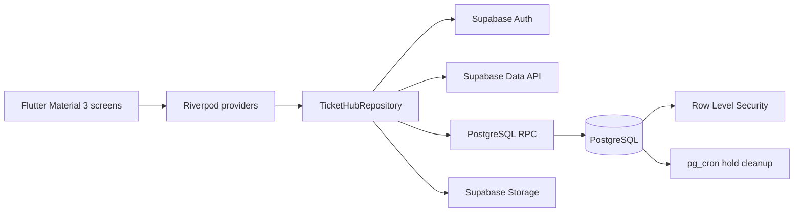
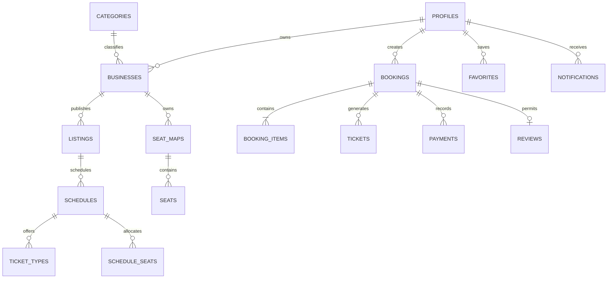

# TicketHub Architecture

## Runtime architecture

The client never decides authoritative inventory, approval, cancellation, or QR-use state. Critical mutations execute in PostgreSQL functions, while RLS protects direct table access.

## Core domain

## Booking transaction boundary

`hold_tickets` validates schedule visibility, booking limit, ticket quantities, seat state and inventory while relevant rows are locked. It creates a Pending booking and increases held inventory. `confirm_booking` converts held inventory to sold inventory, books seats, creates one QR ticket per admission entitlement, records payment, and emits notifications. `release_expired_holds` returns stale inventory; pg_cron invokes the private cleanup every minute and availability reads also invoke it lazily. `cancel_booking` restores eligible inventory and records refund state. `validate_ticket` locks the ticket row and atomically marks it Used.

## General-purpose model

A cinema, concert, sports match, workshop or attraction uses the same `business -> listing -> schedule -> ticket_type` hierarchy. `seat_map_id` is optional, so seated and general-admission products do not require separate code paths or schemas.
